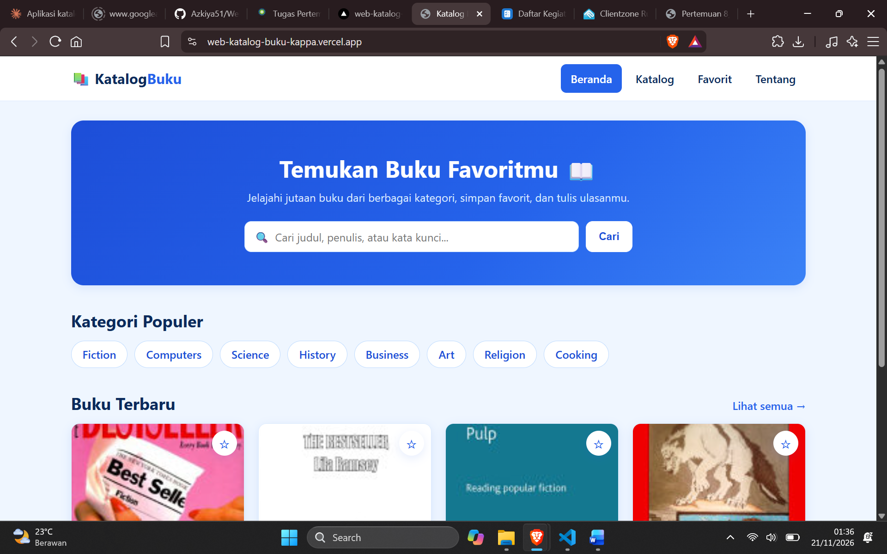
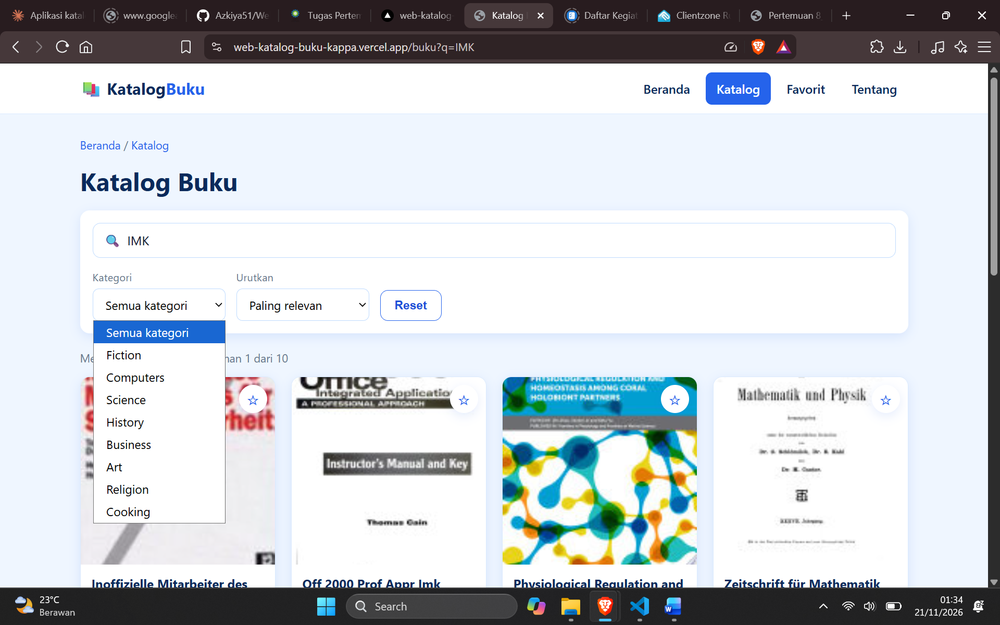
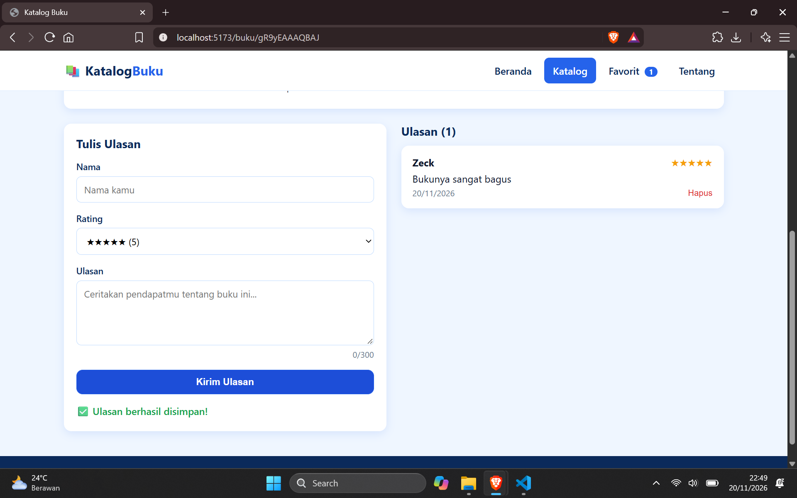
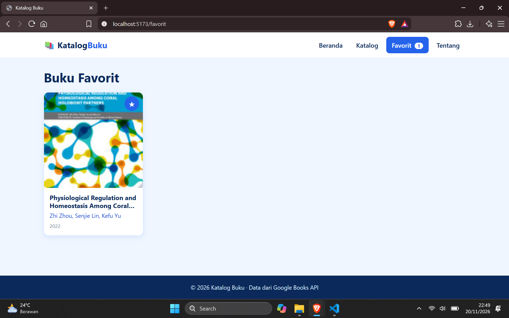

# 📚 Katalog Buku

Aplikasi web katalog buku interaktif yang dibangun dengan **React**, **React Router**, dan **Vite**. Data buku diambil dari **Google Books API**.

Dibuat untuk **Tugas Pertemuan 8** mata kuliah Pengembangan Aplikasi Web
(React Routing, State Management, Data Fetching, dan Application Architecture).

- **Nama**: [Nama Kamu]
- **NIM**: [NIM Kamu]
- **Website**: [https://LINK-WEBSITE-KAMU](https://LINK-WEBSITE-KAMU)
- **Repository**: [https://github.com/USERNAME/katalog-buku](https://github.com/USERNAME/katalog-buku)

---

## 📸 Screenshot

### Halaman Utama
Menampilkan hero dengan kolom pencarian, kategori populer, dan daftar buku pilihan.



### Halaman Katalog
Daftar buku dengan search, filter kategori, sorting, dan pagination. Parameter tersimpan di URL (contoh: `/buku?q=react&kategori=Computers&hal=2`).



### Detail Buku
Informasi lengkap buku berdasarkan ID pada URL (`/buku/:id`), lengkap dengan form ulasan.


### Fitur Interaktif

**Pencarian dan filter**


**Validasi form ulasan**



**Halaman favorit**



---

## ✨ Fitur

- 🔍 **Search** dengan debounce (tidak memanggil API di setiap ketikan)
- 🏷️ **Filter** berdasarkan kategori
- ↕️ **Sorting**: paling relevan, terbaru, judul A–Z, dan judul Z–A
- 📄 **Pagination** dengan parameter halaman di URL
- 📖 **Detail buku** berdasarkan ID (dynamic route)
- ⭐ **Favorit**: simpan buku favorit (tersimpan di `localStorage`)
- ✍️ **Ulasan**: form dengan validasi input, data tersimpan lokal
- ⏳ Indikator **loading**, pesan **error** (dengan tombol coba lagi), dan **empty state**
- 📱 Tampilan responsif (desktop dan mobile)

---

## 🧰 Teknologi

| Teknologi | Kegunaan |
|---|---|
| React 18 | Library UI |
| React Router 6 | Routing dan navigasi |
| Vite | Build tool dan dev server |
| Google Books API | Sumber data buku |
| CSS | Styling tema biru dan putih |

---

## 📝 Penjelasan Singkat

### 1. Routing
Routing memakai **React Router** dengan *client-side routing*, sehingga perpindahan halaman tidak me-reload browser.

| Path | Halaman |
|---|---|
| `/` | Beranda |
| `/buku` | Katalog (daftar buku) |
| `/buku/:id` | Detail buku (**dynamic route**) |
| `/favorit` | Buku favorit |
| `/tentang` | Tentang aplikasi |
| `*` | Halaman 404 |

- **Nested route**: semua halaman berada di dalam `Layout` (Navbar + footer) melalui `<Outlet />`. Rute `/buku` memiliki layout sendiri (`BooksLayout`) yang membungkus daftar buku (index route) dan detail buku (`:id`).
- **Navigasi** memakai `NavLink` (menu aktif otomatis ditandai) dan `Link`, tanpa reload penuh.

### 2. State Management

| Jenis state | Implementasi |
|---|---|
| **Local state** | `useState` untuk buka/tutup menu mobile di `Navbar` dan teks input pencarian di `BooksPage` |
| **Global state** | **Context API** (`LibraryContext`) untuk daftar favorit dan ulasan yang dipakai banyak komponen |
| **Server state** | Hook `useFetch` mengelola `data`, `loading`, dan `error` dari API |
| **URL state** | `useSearchParams` menyimpan `q`, `kategori`, `urut`, dan `hal` di URL, sehingga hasil pencarian bisa dibagikan dan tetap ada saat refresh |
| **Form state** | *Controlled components* di `ReviewForm` dengan validasi dan pesan error |

### 3. API
- Data diambil dari **Google Books API** (`https://www.googleapis.com/books/v1/volumes`) menggunakan `fetch`.
- Semua pemanggilan API dipusatkan di `src/services/bookService.js` (fungsi `fetchBooks` dan `fetchBookById`), termasuk normalisasi data, sehingga komponen tidak berhubungan langsung dengan API.
- Permintaan dibatalkan dengan `AbortController` saat komponen unmount atau parameter berubah.
- Tiga kondisi ditangani di UI: **loading** (`Loader`), **error** (`ErrorMessage`), dan **data kosong** (`EmptyState`).

### 4. Custom Hooks

| Hook | Fungsi |
|---|---|
| `useFetch` | Mengambil data dan mengembalikan `data`, `loading`, `error`, serta `refetch` |
| `useDebounce` | Menunda nilai input agar pencarian tidak memanggil API di setiap ketikan |
| `useLocalStorage` | Menyimpan dan membaca state dari `localStorage` (dipakai untuk favorit dan ulasan) |

### 5. Validasi Form (Ulasan)
- **Nama**: wajib diisi, minimal 3 karakter.
- **Ulasan**: wajib diisi, minimal 10 dan maksimal 300 karakter.
- Pesan error tampil di bawah kolom yang tidak valid, dan form tidak terkirim sebelum semua input benar.

### 6. Struktur Folder

```
katalog-buku/
├── public/
├── src/
│   ├── components/     # Komponen reusable
│   │   ├── Layout.jsx
│   │   ├── Navbar.jsx
│   │   ├── BookCard.jsx
│   │   ├── SearchBar.jsx
│   │   ├── FilterBar.jsx
│   │   ├── Pagination.jsx
│   │   ├── Loader.jsx
│   │   ├── ErrorMessage.jsx
│   │   ├── EmptyState.jsx
│   │   └── ReviewForm.jsx
│   ├── pages/          # Halaman (dipetakan ke route)
│   │   ├── HomePage.jsx
│   │   ├── BooksLayout.jsx
│   │   ├── BooksPage.jsx
│   │   ├── BookDetailPage.jsx
│   │   ├── FavoritesPage.jsx
│   │   ├── AboutPage.jsx
│   │   └── NotFoundPage.jsx
│   ├── hooks/          # Custom hooks
│   │   ├── useFetch.js
│   │   ├── useDebounce.js
│   │   └── useLocalStorage.js
│   ├── services/       # Akses API
│   │   └── bookService.js
│   ├── context/        # Context API (global state)
│   │   └── LibraryContext.jsx
│   ├── utils/          # Konstanta (kategori, opsi sorting)
│   ├── App.jsx         # Definisi route
│   ├── main.jsx        # Entry point
│   └── index.css       # Styling
├── index.html
├── vite.config.js
└── package.json
```

**Separation of concerns**
- **Tampilan**: `components/` dan `pages/`
- **Logika aplikasi**: `hooks/` dan `context/`
- **Akses API**: `services/`

---

## 🚀 Menjalankan Proyek

### 1. Clone repository
```bash
git https://github.com/Azkiya51/Web_Katalog_Buku.gitgit
cd katalog-buku
```

### 2. Instal dependensi
```bash
npm install
```

### 3. Buat file `.env`
Buat API key di [Google Cloud Console](https://console.cloud.google.com) (aktifkan **Books API**), lalu buat file `.env` di root proyek:


### 4. Jalankan
```bash
npm run dev
```
Buka `http://localhost:5173`.

### Build produksi
```bash
npm run build
npm run preview
```

---

## ☁️ Deployment

Aplikasi di-deploy ke **Vercel**.
- File `vercel.json` mengarahkan semua path ke `index.html` agar refresh pada route seperti `/buku/:id` tidak menghasilkan 404.

---

## 📄 Lisensi

Proyek ini dibuat untuk keperluan pembelajaran.